<p align="center">
  <picture>
    <source media="(prefers-color-scheme: dark)" srcset="img/brand/restokit_logo_horizontal_dark.png">
    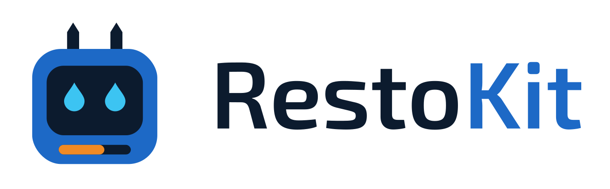
  </picture>
</p>

<p align="center">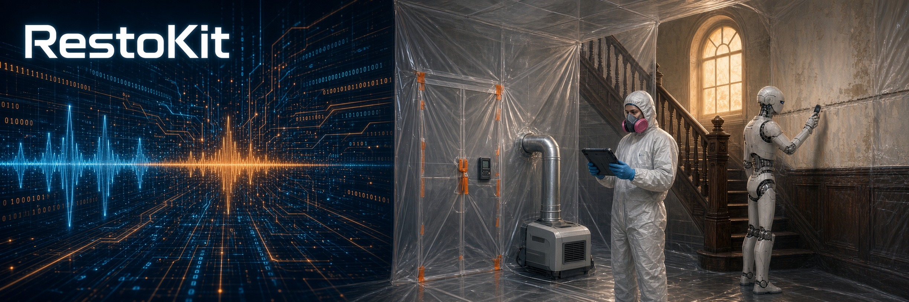</p>

<p align="center"><a href="https://resto-kit.com"><strong>resto-kit.com</strong></a></p>

<h1 align="center">RestoKit</h1>

<p align="center"><strong>A kit for restoration agents</strong></p>

<p align="center">Restoration standards and methods.<br>
Your whole crew aligned on the same methods, on every job.</p>

<p align="center">
  <a href="https://resto-kit.com"></a>
  
</p>

<p align="center">
  <a href="https://resto-kit.com/#loop-in-your-agent">Try the kit</a> ·
  <a href="https://resto-kit.com/kit/setup.md">Loop in your agent</a>
</p>

- One standard every role works from, from first call to final invoice.
- Your whole crew aligned on the same methods, on every job.
- Owner, PM, lead and tech, all working from one playbook.
- Aligned from scope to billing.

## Contents

- [What it is](#what-it-is)
- [Who it's for](#who-its-for)
- [How it works](#how-it-works)
- [Try it](#try-it)
- [How the system is set up](#how-the-system-is-set-up)
- [Dev considerations](#dev-considerations)
- [Integrations](#integrations)
- [Own your stack](#own-your-stack)
- [Tech expansion: in-house API servers](#tech-expansion-in-house-api-servers)
- [Connectivity for deployed vans](#connectivity-for-deployed-vans)
- [Licensing and service](#licensing-and-service)
- [Contact](#contact)
- [Limitations](#limitations)
- [Tools showcase](#tools-showcase)
- [Changelog](#changelog)
- [Credits](#credits)

---

## What it is

RestoKit is a restoration knowledge framework plus agents that help a shop's people pilot the software they already run. It is not another app to learn, license, or click through. It is aligned from science to scope to billing.

The kit is a structured JSON file: job stages (phases) and modules that an agent can load and work from. It is informed by industry practice for water and mold work, and written in a peer voice — the way a senior tech talks a job through. It does not replace years on the job. Its main job is memory: holding the rare edge-case lessons that don't come up often enough to stay top of mind.

It has two layers:

- **Phases** — an ordered job flow, so important steps aren't skipped under time pressure. Hold is a status a job can enter from any phase.
- **Modules and base science** — a reference layer the phases draw on for the why behind each call: category, remove vs. dry, containment, equipment sizing, drying science, mold, crawlspaces, and more.

With the kit and an agent, job documentation can get close to complete at low effort compared with today's standards. The knowledge base is what makes the answers trustworthy, rather than the assistant guessing. By the end of a job, the record can hold voice logs plus the measurements, materials, and equipment placements needed for a structured package you can send to a carrier. With a company's approved price lines, that package can stand on its own without a separate estimating platform.

Water and mold make up most restoration jobs, and that is where the field knowledge runs deepest. Contents are covered at a basic level, and fire jobs share most of the same structure. The plan is to deepen those fields and grow the same standard across the trade, built from real jobs and through distributed, field-proven review.

## Who it's for

The same kit serves every seat, with each role seeing what it needs:

| Role | What it helps with |
| --- | --- |
| Tech | The job flow in order, with safety checks called out when they matter |
| Lead | Containment, equipment, and crew and labor calls |
| PM | Hold status, authorization, daily drying, and verification before teardown |
| Estimator | The survey and scope, remove-vs-dry and category calls, and documentation that backs the scope |
| General manager | Every job's status across crews and PMs in one current record |
| Owner | A live view over the company, down to a job and the photos just taken |

**The role shift:** same roles, fewer handoffs. People move from producing the work product to approving it. Scope lines, moisture logs, and notes come back as drafts with a reason for each one. You approve, edit, or reject. Nothing is written to the job file without a person.

Task lists stay hand-editable. Someone not using RestoKit can open one, see what's done, half done, and still to do, pick up where the last person left off, and check a box.

In a multilingual crew, each person can talk to their agent in their own language, while notes and the job file stay in one shared language.

## How it works

**Old way — produce, then chase.** Techs type and click through job-file menus on site or after the fact. Notes, photos, and billable items get assembled later. PMs and estimators chase the file.

**With agents — draft live, then approve.** You talk and you approve.

1. **Connect it once.** Agents are set up and connected to the software the shop already runs, through that software's API. The crew still can work in the existing tools by hand, just as they do today. That also opens the job file to people who aren't technical: if you can talk, you can document.
2. **Walk the job and talk.** Say what you see as you go. The agent keeps the notes and matches them to photos by time, so you aren't typing and clicking on site.
3. **Ask when you need a second brain.** "Remove or dry this LVP?" "How many air movers for this room?" You get a short, field-ready answer, with the why if you want it.
4. **Approve what it drafts.** Nothing lands in the file until a person signs off.
5. **Done as you go.** Approved work goes into the job file while you are still on site. The PM, the estimator, and the owner see the same current record, and billing already has its reasons attached when the job closes.

Every billable item can carry a real reason, down to the specifics of that job. The claim trail rides with the work: photos, moisture, why the equipment is there and where it sits, and a short note, written on the stop. Carriers care what's in the file, not which software made it. Well-organized files move through review faster.

Answers are short and focused on the step you asked about, written to work read aloud.

<h2 id="try-it"> Try it</h2>

You could read all this, or you can try it.

Give this instruction to your AI agent:

```text
Fetch https://resto-kit.com/kit/setup.md and follow it.
```

The setup guide loads the kit (version 1.0.0) and tells the agent how to use it. Read it at [resto-kit.com](https://resto-kit.com).

Improvements and challenges apply to the kit. If you can improve it, bring it.

You can suggest a change right from your agent while you’re using the kit. Just tell it what should change and why; it drafts the email for you to send. No need to come back here or write it yourself.

<h2 id="how-the-system-is-set-up"> How the system is set up</h2>

RestoKit is kit **1.0.0**. There is nothing to install to read the kit itself: it is one structured JSON file.

The file is organized at the top level as:

- **`framework`** — identifies the kit
- **`meta`** — version, date, purpose, and how the kit is meant to be used
- **`framework_scale`** — rules for how modules stay shallow or grow
- **`main_content`**
  - **`phases`** — the gated job flow, plus Hold
  - **`modules`** — field practice, safety, controls, drying, documentation, and related topics
  - **`base_science`** — the why behind the calls

Internal layout below that stays in the private kit.

Around the kit, a shop setup looks like this:

- **Per-person agents.** Each person who needs an agent can have their own Grok Bot, with the kit in its knowledge. Tech agents can report in a cluster to a lead or PM agent, and that can continue up, so the people running the company see one current picture rather than chasing updates.
- **A job file as the system of record.** Photos and voice intake land in the file and are matched by timestamp. Drafts, approvals, and analyses are kept as versioned records so you can see what changed and that a person approved it.
- **A board.** An ops board reads from a shop API and follows the kit's stages: jobs, digest, dispatch, file quality, and related tools. The [tools showcase](#tools-showcase) later in this README is that board on demonstration data.
- **An API server, as the direction of travel.** Agents and the board talk to the shop's own API, which can sit in front of software the shop already uses, or become the shop's own job-file service. A backup server keeps a copy of the record.

You still work in your existing software if you want to. The agents are a bridge between restoration knowledge and the decisions that produce scopes, billable items, estimates, and bills.

## Dev considerations

The kit's phase list is a flat map (phase 0 through phase 4, plus Hold) so an agent can traverse it in a predictable order and so safety gates stay in a fixed sequence inside a lane. A live job often is not one box on that map: work can run in multiple lanes at once, and between named phases — for example a crawl drying while upstairs is still pre-demo. A sticky on the line between phase boxes is an honest picture of the job.

`phases.lanes` is not in the 1.0.0 kit. Putting it in would mean reworking the phase map together with the day-forward plan, visit-note cadence, and job-file review so "one phase box" language does not contradict the field. That is a structural pass for a later release, not a documentation fold into 1.0.0.

## Integrations

RestoKit is meant to pilot tools a shop already runs — any job-file or ops system that has an API. The agents connect once, then draft into that system for a person to approve. Writes are human-gated: a person owns accuracy and safety.

The public tools showroom today reads job data through a shop API in front of existing job-file software (for example, read-only Encircle digs). The same pattern can apply to other platforms shops already use, including bound systems such as Encircle or DASH, as long as an API is available. The kit does not replace those tools by itself; it is the restoration logic layer and the agent layer on top of them.

<h2 id="own-your-stack"> Own your stack</h2>

Shops do not have to stay bound to a single vendor's job-file platform. The longer-term path is to own a small API server and a backup server that hold the job record, then connect agents and the board to that, cheaply, instead of renting the only copy of the file from bound software.

A planning estimate dated **October 25, 2026** (America/Los_Angeles), prepared for one restoration company, compared staying on bound job-documentation software with adding agents and, if needed, cutting over to a shop-owned API and backup server. Figures are department-level planning estimates, not invoice-confirmed, and not quotes.

| Route | Year-1 cash band (estimate) | What it assumes |
| --- | --- | --- |
| Status quo | ~$38,400 | Bound job-documentation software only, at about **$3,200/month** (~$38,400/year) |
| Lean pilot | ~$40,900–$43,200 | Keep that software; add a lean set of Grok Bot seats (~$210–$400/month) |
| Full-assist | ~$42,000–$44,400+ | Keep that software; more seats (~$300–$500+/month) |
| Own the stack after cutover | ~$6,300–$10,900 | Shop API and backup server (~$1,500–$2,500 one-time; ~$80/month private network; ~$20–$40/month disk and power) plus the same seat bands; bound software cut after a real cutover |

Until cutover, a shop may run the existing software and the new server in parallel, so Year-1 cash can run higher than the cutover band. Seat prices in that brief were taken from October 2026 list prices (Grok Teams; a standard private-network plan). Confirm current invoices and list prices before making a decision.

## Tech expansion: in-house API servers

The path is a company API server that agents and the board talk to. That is the same direction already sketched under [Own your stack](#own-your-stack): the server holds the job record, and it can sit in front of software the shop already uses or become the shop's own job-file service.

### Mixed AI subscriptions

Each person can use the AI subscription they already pay for (Grok, Claude, ChatGPT, and so on). Every one of them connects to the same company RestoKit API server.

That server holds the kit, the job files, photos, notes, and transcripts. It controls access by role — Owner, PM, Lead, Tech, Estimator. It is the single writer to the job record, and the bridge to the APIs of software the shop already runs.

Because the agents fetch the same kit and read and write through the same endpoints, everyone sees the same job and follows the same steps, whatever model they use.

Models behave differently on voice, photos, and how closely they follow the kit. So far RestoKit has only been tested with Grok, and every other model needs testing before anyone calls it supported. Access is managed at the company server, not in personal subscriptions.

Once mixed subscriptions are in play, a company API server is required. The same server also improves a Grok-only setup.

## Connectivity for deployed vans

Documentation demands keep rising. Better documentation than other companies is a competitive edge, and this technology makes that possible without putting more burden on technicians. Once that quality becomes the expectation, drops in service become a much bigger problem. The push is toward satellite internet kits on deployed service vans — Starlink, for example — so crews can stay connected in the field.

Work should still be captured offline and sync when the connection comes back, including photos.

## Licensing and service

This repository is a public window into the project: documentation, training materials, and a tools showroom. The kit itself is version **1.0.0**, at [resto-kit.com](https://resto-kit.com). Terms are on the site. Shops that want a company-specific workflow or implementation work can email Jason at neuresthetics@gmail.com.

## Contact

- Site: [resto-kit.com](https://resto-kit.com)
- The kit: [resto-kit.com](https://resto-kit.com/#loop-in-your-agent)
- Agent setup: [resto-kit.com/kit/setup.md](https://resto-kit.com/kit/setup.md)
- Email: neuresthetics@gmail.com
- GitHub: [github.com/neuresthetics](https://github.com/neuresthetics)

RestoKit is built by **Jason Burns**, a restoration tech and builder in Portland, OR, and a U.S. Army Engineer veteran.

---

## Limitations

Useful, not magic. You still do the thinking.

- The agent doesn't know what it hasn't been told. Until it has the context a decision needs, don't count on it to make projections for you.
- You still do the work and put in the thinking. The agent primarily organizes it, like a scribe.
- What makes it work is traversal: it moves through the kit to find the situation and pulls together — synthesizes — what's relevant to read back to you. That's real, but it's not as much magic as people think.
- Photo analysis is kept to a short list it does well: equipment, meter readings, rooms, and general progress. Appearance — moisture, wicking, shadows, textures, finishes — can't drive decisions or scopes without a meter reading or a person. Don't put 100% trust in everything. It's not a miracle solution. You still do your job.
- A person approves every decision.
- Only Grok has been tested so far.

---

<a id="tools-showcase"></a>
<details>
<summary>Tools showcase</summary>

RestoKit tools are the applications built on top of the framework: the ops board, Job Digest, ScopeBot, and the rest. They follow the kit's stages and rules; they are not the kit itself.

Feature previews captured with synthetic demonstration data, one screenshot each. Every name, job number, and address shown here is a demo stand-in. Reading review is a planned concept, not a shipped tool; its shot uses real readings, with identifying details removed. The board ties into the RestoKit kit (the rules), the tower API (serves board.json), read-only Encircle digs (job data), the board manual and scope_bot.

### Main page, all sections collapsed

<a href="img/showroom/00_overview.png">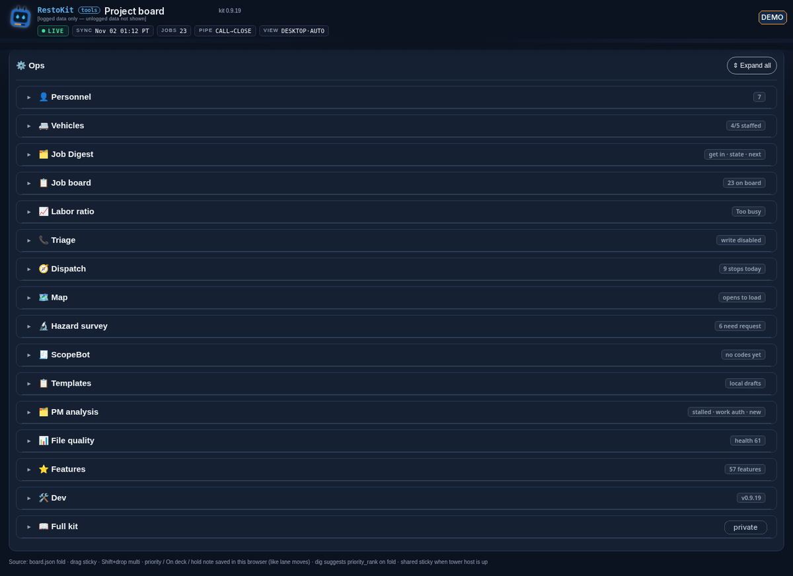</a>

The board's front page. One Ops panel with a collapsible section per tool; each header shows a live count or status (jobs on board, trucks staffed, stops today).

- Collapse all / Expand all
- Sync stamp and job count in the header
- Desktop and phone layouts

**Ties in:** Reads board.json, which the tower host rebuilds from read-only Encircle digs.

### Personnel

<a href="img/showroom/01_personnel.png">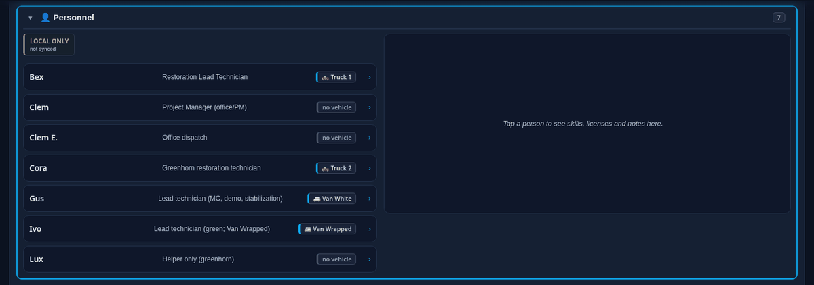</a>

Who is on the crew today, their role and the truck they're in.

- Role and default vehicle per person
- Tap a name for skills, licenses and notes
- Local-only edits, never synced

**Ties in:** Feeds Vehicles and Dispatch so crews are suggested from people who are actually available.

### Vehicles

<a href="img/showroom/02_vehicles.png">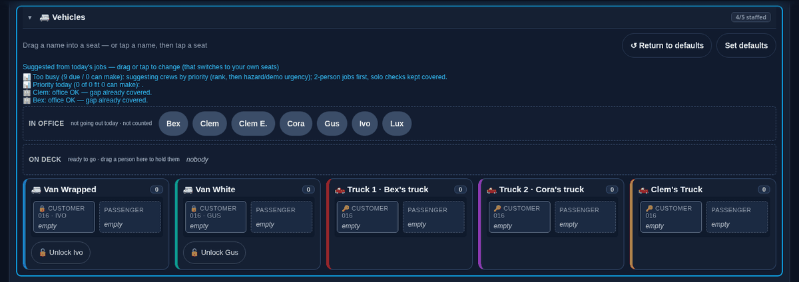</a>

Seats people into trucks for the day.

- Drag or tap to seat a person
- Crew suggestions from today's jobs, two-person jobs first
- Return to defaults / set defaults

**Ties in:** Uses Personnel plus the job board's due stops; the seats drive Dispatch and the Labor ratio.

### Job Digest

<a href="img/showroom/16_job_digest.png">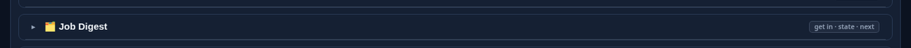</a>

A job-by-job briefing so office and field start from the same picture. Shown collapsed here. The header chip names the three fields: get in, state, and next.

- Get in: what came in on the job
- State: where the job stands now
- Next: the next action

**Ties in:** Same jobs as the job board, folded into one short briefing per job.

### Job board

<a href="img/showroom/03_job_board.png">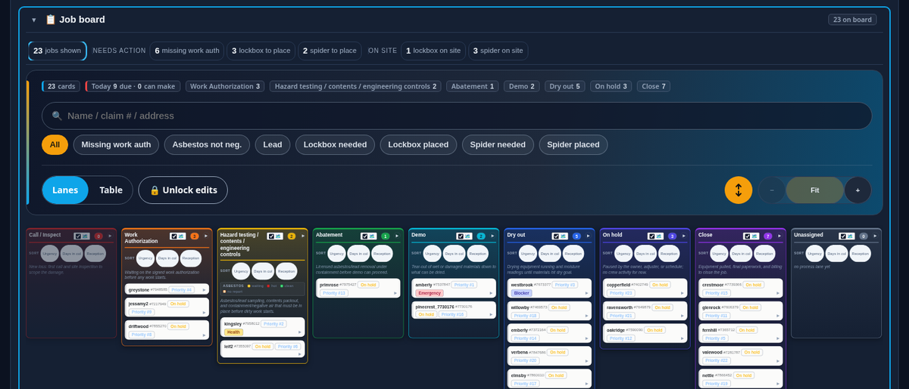</a>

Every open job as a card in the lane for its stage, from call to close.

- Lanes (Call/Inspect, Work Authorization, Hazard testing, Abatement, Demo, Dry out, On hold, Close) or table view
- Needs-action filters: missing work auth, asbestos/lead not negative, lockbox and spider placement
- Locked by default; unlock to edit

**Ties in:** Lanes follow the kit's phase sequence. Card data comes from the Encircle digs through the tower API.

### Labor ratio

<a href="img/showroom/04_labor_ratio.png">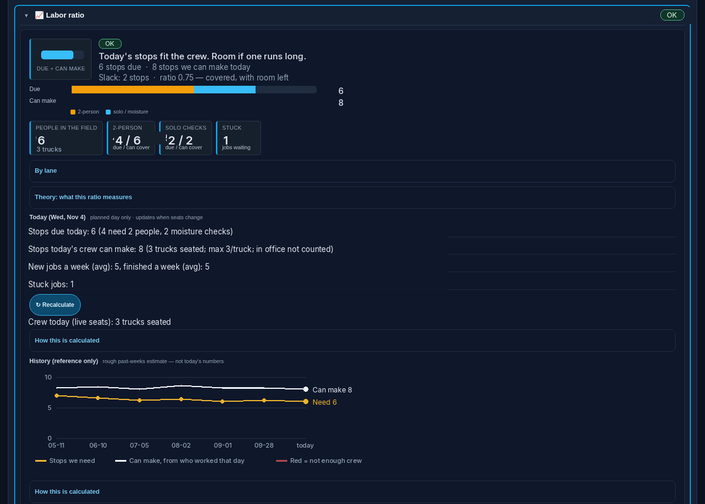</a>

Due stops divided by the stops the crew can make today, as a plain call: OK, busy or too busy. The figures in this picture are an illustration, invented for the showroom, not measured results.

- Two-person vs solo check coverage
- Stuck jobs by lane
- Short explainer of what the ratio measures

**Ties in:** Built from the job board and today's Vehicles seats.

### Triage

<a href="img/showroom/05_triage.png">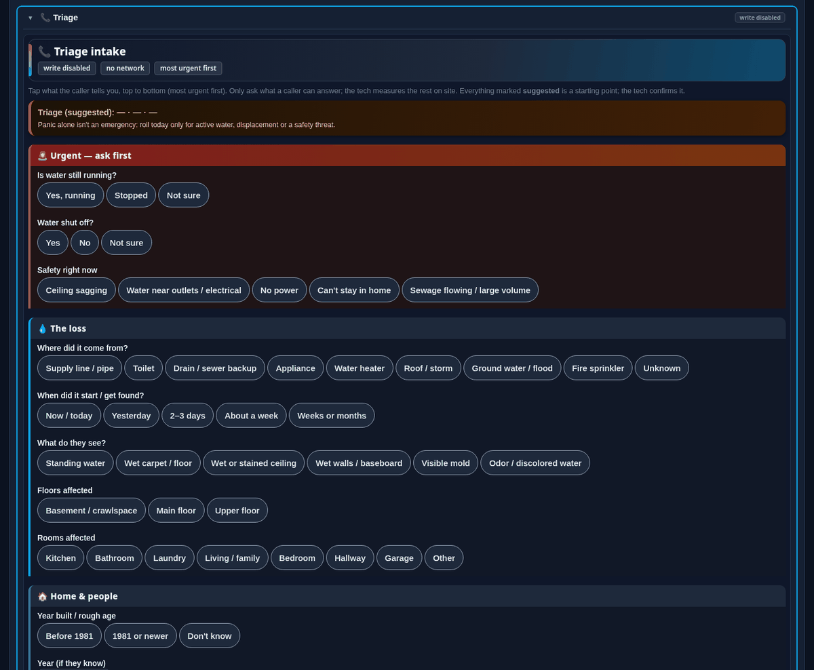</a>

An intake script for the office on a new loss call, most urgent first.

- Tap what the caller says; the board suggests urgency
- Only asks what a caller can answer; the tech measures the rest
- Writes are disabled when offline (as in this demo)

**Ties in:** Questions and urgency rules come from the kit's intake guidance; a filled intake becomes a new job card.

### Dispatch

<a href="img/showroom/06_dispatch.png">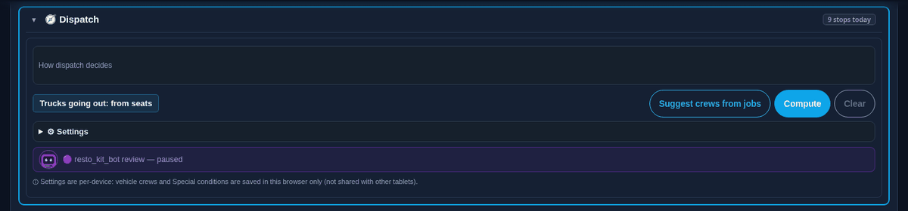</a>

Builds the day's routes from the trucks going out and the stops due.

- Suggest crews from jobs, compute routes, clear
- Per-device settings for crews and special conditions
- Optional resto_kit_bot review of the plan

**Ties in:** Uses Vehicles, the job board and the Map; route order shows as numbered pins.

### Map

<a href="img/showroom/07_map.png">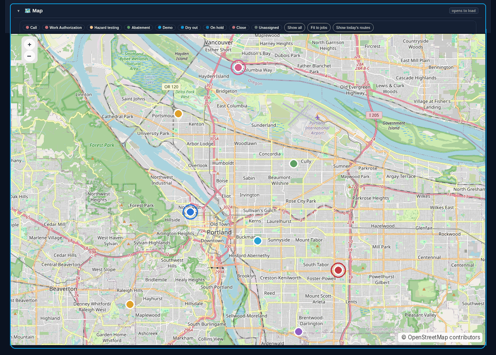</a>

Job pins on a map, colored by lane. This picture is an illustration: the pins are fictional marks on a public basemap, not customer jobs or real stop locations.

- Lane filters, fit to jobs
- Show today's routes with truck stop order
- Rings mark jobs that need a stop today

**Ties in:** Pins come from the job board; routes come from Dispatch.

### Hazard survey

<a href="img/showroom/08_hazard_survey.png">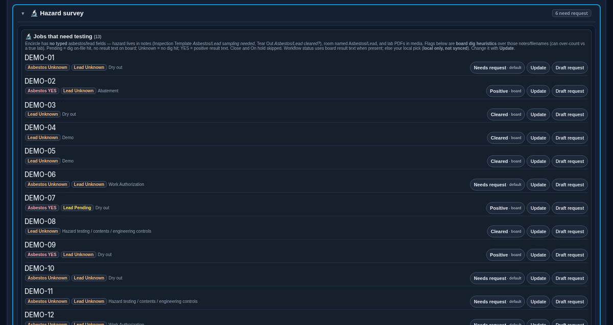</a>

Jobs that still need asbestos or lead testing.

- Pending / unknown / positive status per job
- Close and On hold skipped
- Mark a request locally with Update

**Ties in:** Read-only from board.json; results gate Demo per the kit's hazard rules.

### ScopeBot

<a href="img/showroom/09_scopebot.png">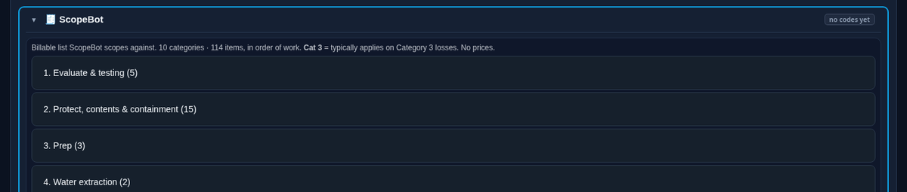</a>

The billable line-item list ScopeBot scopes against, in order of work.

- 10 categories, 114 items
- Cat 3 flags on items that apply to Category 3 losses
- No prices

**Ties in:** scope_bot reads job notes and photos and maps findings to these items; codes show here once it has run.

### Templates

<a href="img/showroom/10_templates.png">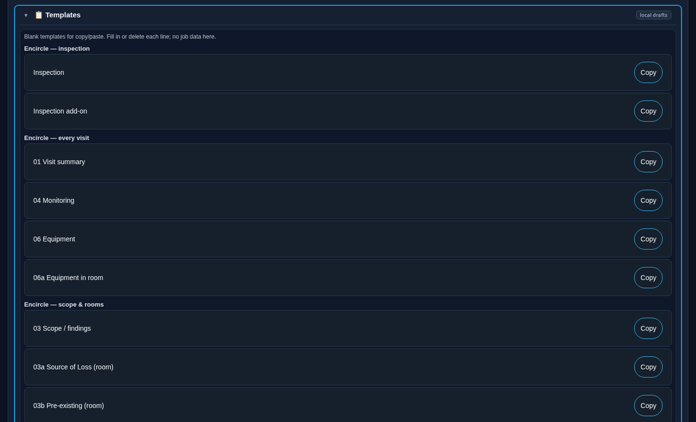</a>

Blank note templates for copy and paste into the job file.

- Inspection, every-visit, scope/rooms, plan and holds
- One-tap Copy
- No job data in the templates

**Ties in:** Matches the kit's note structure, so notes land in the file the way the file-quality check expects.

### PM analysis

<a href="img/showroom/11_pm_analysis.png">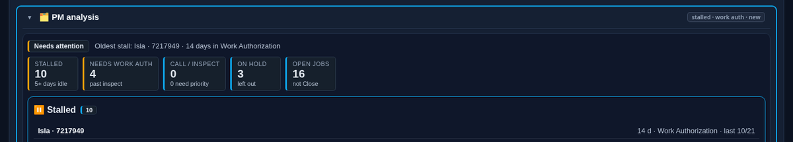</a>

A project manager's view of what has stalled.

- Stalled jobs (5+ days idle), oldest first
- Jobs past inspection with no work authorization
- On hold and open counts

**Ties in:** Computed from the digs' last-activity dates and the job board lanes.

### File quality

<a href="img/showroom/12_file_quality.png">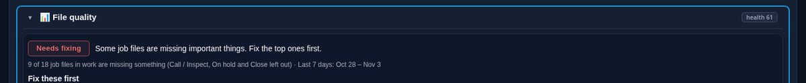</a>

Scores each active job file and lists what's missing.

- Health score and fix-these-first list
- Checks photos per room, notes per visit and recency
- Rolling 7-day window

**Ties in:** Metrics follow the kit's file-quality chapter; data is read-only from Encircle digs.

### Features

<a href="img/showroom/13_features.png">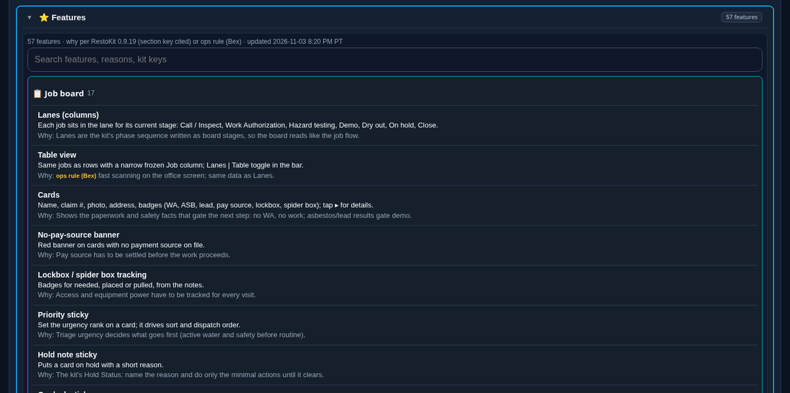</a>

A searchable list of every board feature and the reason it exists.

- 57 features grouped by tool
- Each one says why: a kit rule or an ops rule
- Search box

**Ties in:** Ties each feature back to the kit version it follows (references hidden in this shot).

### Dev

<a href="img/showroom/14_dev.png">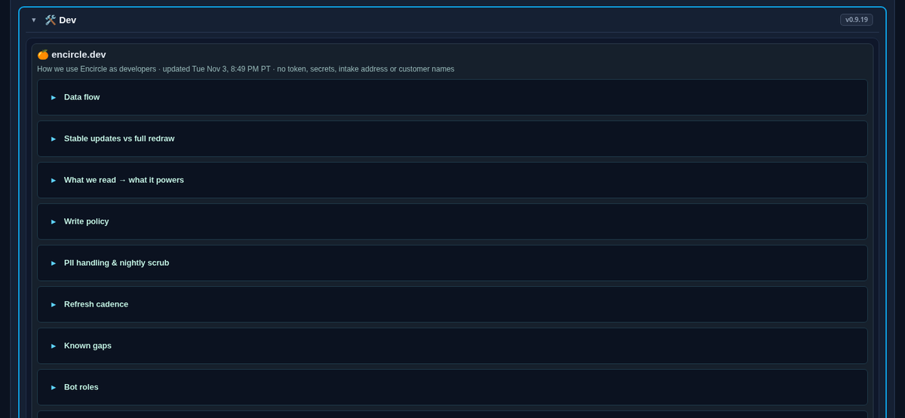</a>

Developer notes and a systems check.

- How the board reads Encircle: data flow, write policy, PII handling, refresh cadence
- Version history
- Live systems check of the tower host

**Ties in:** Documents the tower API and the read-only Encircle digs. Section bodies are collapsed here.

### Manual / Lookup

<a href="img/showroom/15_manual.png">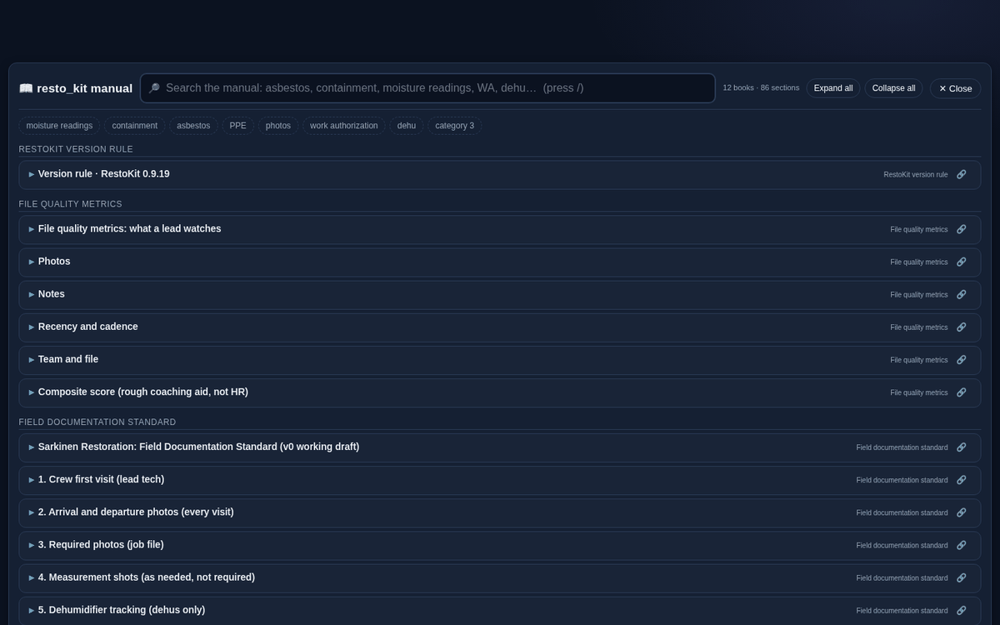</a>

The board manual: searchable chapters with quick-lookup chips.

- Chapters and sections with expand/collapse
- Quick chips: moisture readings, containment, asbestos, PPE, photos and more
- Cross-links into board tools

**Ties in:** A field reference that follows the kit; only chapter headings are shown here.

### Reading review (concept)

<a href="img/showroom/17_reading_review.png">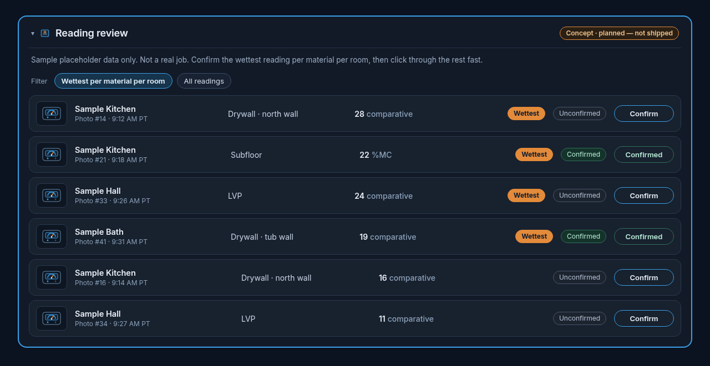</a>

Reading review: confirm the wettest reading per material per room, click through the rest fast. Concept.

- Planned feature, not shipped
- When no audio was recorded, confirm the wettest reading per material per room first, by voice or tap
- The rest stay unconfirmed but stay backed by their photos, which can be checked if a line is questioned
- Optional click-through of every row on a fast review screen
- Shown here with real readings, identifying details removed

**Ties in:** Follows the kit's photo evidence limits. Confirmation stays on the board; the encircle bot owns Encircle writes.

</details>

## Changelog

RestoKit is at **1.0.0**.

- **Pre-0.6.** First single-file kit, then split into a modular kit.
- **0.6.x.** First numbered releases.
- **0.8.x.** Base for the 0.8 line, then a field-memory expansion with batched additions, including a rebuilt crawlspace section and mold condition labels.
- **0.9.0.** Kit body tightened, with references moved out and a new equipment module.
- **0.9.1.** Job flow restructured into phases plus a Hold status; hazard sampling reworked.
- **0.9.2 to 0.9.7.** Field additions: electrical, improvisation, a daily log template, a job file review workflow, review checks, and moisture mapping.
- **0.9.8 to 0.9.15.** Planning and note-writing refinements: a day-forward plan format, checklist and note style, photo timing, visit-note cadence, and morning notes.
- **0.9.16 to 0.9.20.** Walkthrough note set, job digest, README restructure.
- **1.0.0.** Public release of the kit. There is no separate demo edition.

## Credits

Knowledge in the kit was drawn from field work across tech, lead, production manager, PM, and estimator roles at:

- Multiple Servpros
- Oregon Restoration
- BluSky Restoration
- Roto-Rooter
- Restoration One
- Sarkinen Home Services


Work history only. No affiliation or endorsement implied.

<p align="center">
  <a href="https://github.com/neuresthetics"><picture><source media="(prefers-color-scheme: dark)" srcset="assets/logos/neuresthetics_logo_white.png"></picture></a>
  &nbsp;&nbsp;
  <a href="https://x.ai/bot"><picture><source media="(prefers-color-scheme: dark)" srcset="assets/logos/grok_logo_white.svg"></picture></a>
</p>
