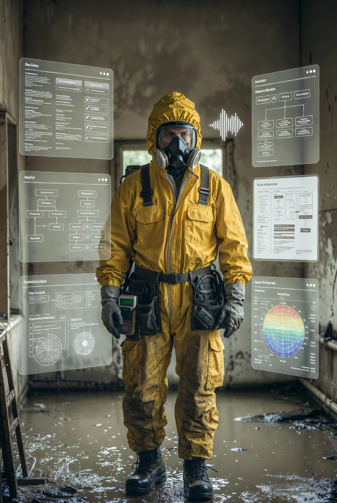

  <picture>
    <source media="(prefers-color-scheme: dark)" srcset="img/brand/restokit_logo_horizontal_dark.png">
    
  </picture>

<strong>A restoration kit for water, mold, and crawlspace work, from tech to lead, PM, and estimator.</strong>

  
  
  
  

  <strong>RestoKit (the framework):</strong>
  <a href="#-what-it-is">What it is</a> ·
  <a href="#%EF%B8%8F-development-history">Development history</a> ·
  <a href="#%EF%B8%8F-what-it-covers-on-a-job">What it covers on a job</a> ·
  <a href="#-checks-the-kit-calls-out">Checks</a> ·
  <a href="#-the-science-behind-the-calls">Science</a> ·
  <a href="#%EF%B8%8F-kit-structure">Kit structure</a> ·
  <a href="#-how-to-use-it">How to use it</a> ·
  <a href="#-how-it-answers">How it answers</a> ·
  <a href="#-how-it-grows">How it grows</a> ·
  <a href="#-where-its-headed">Where it's headed</a> ·
  <a href="#-how-it-changes-the-day-for-a-technician">How it changes the day</a> ·
  <a href="#-for-shops">For shops</a> ·
  <a href="#-about">About</a>
   
  <strong>RestoKit tools (the showcase):</strong>
  <a href="#-restokit-tools-feature-showroom">Feature showroom</a> ·
  <a href="#-a-note-on-this-repo">A note on this repo</a>

---

# RestoKit: the framework

RestoKit is the framework: the job stages (phases) and the modules that load into an AI model. Everything in this part of the page is about the kit itself: what it is, where it came from, and how it is built.

## 🧰 What it is

RestoKit is a structured kit that loads into an AI model and works alongside anyone running a restoration job, from tech and lead to project manager and estimator. It's informed by industry practice for water and mold work and written in a peer voice, the way a senior tech talks a job through. For now it runs on commercial models only.

It has two layers:

- **Phases:** an ordered job flow, so important steps aren't skipped under time pressure.
- **Modules and base science:** a reference layer the phases draw on for the why behind each call.

It's meant to put senior field knowledge in a form a tech, lead, PM, or estimator can use. It doesn't replace years on the job. Its main job is memory: holding the rare edge-case lessons that don't come up often enough to stay top of mind.

## 🕰️ Development history

- **Pre-0.6.** First single-file kit, then split into a modular kit.
- **0.6.x.** First numbered releases.
- **0.8.x.** Base for the 0.8 line, then a field-memory expansion with batched additions, including a rebuilt crawlspace section and mold condition labels.
- **0.9.0.** Kit body tightened, with references moved out and a new equipment module.
- **0.9.1.** Job flow restructured into phases plus a Hold status; hazard sampling reworked.
- **0.9.2 to 0.9.7.** Field additions: electrical, improvisation, a daily log template, a job file review workflow, review checks, and moisture mapping.
- **0.9.8 to 0.9.15.** Planning and note-writing refinements: a day-forward plan format, checklist and note style, photo timing, visit-note cadence, and morning notes.
- **0.9.16 to 0.9.20.** Walkthrough note set, job digest, README restructure.

## 🏗️ What it covers on a job

- **Phase 0, Survey & Estimate:** the first look before work is authorized, through to the scope and job file the crew inherits.
- **Phase 1, Initial Response & Stabilization:** safety, source control, extraction, and baseline documentation.
- **Phase 2, Selective Demolition & Post-Demo Cleaning:** remove-or-dry decisions, controls, demo, and cleanup.
- **Phase 3, Active Drying & Monitoring:** drying, daily monitoring, and catching stalled progress.
- **Phase 4, Verification & Closeout:** verifying dry, teardown, walkthrough, and documentation.
- **Hold Status (any phase):** keeping a paused job stable and documented until it can resume.

## ✅ Checks the kit calls out

The kit flags judgment calls and safety checks across the job, including water category, electrical safety, wet-edge mapping, crawlspace safety, containment, pressure and airflow, dry standards, and mold condition. Specific rules and thresholds stay in the private kit.

## 🔬 The science behind the calls

The base science layer includes notes on psychrometry, moisture and vapor behavior, how water moves through a building, material behavior, contamination and mold science, and equipment sizing principles.

---

## 🗂️ Kit structure

RestoKit is organized as a single structured file: kit metadata, the job phases, a set of topic modules (field practice, safety, controls, drying, documentation, legal and insurance awareness, crew and logistics), a base science section, and a changelog. Internal layout is private.

## 🚀 How to use it

RestoKit is a single file. There's nothing to install and no code to run.

1. **Load it.** Attach the kit in the Grok app or a Grok Bot, or add it to a project or bot's knowledge so it stays loaded.
2. **Tell it the job.** For example, "Category 2 supply-line leak, kitchen and crawlspace, I'm the PM."
3. **Ask one thing at a time.** For example, "What's Phase 1?" or "Is this ready for demo?" It answers from the kit and goes deeper only when you ask.

The full kit is private for now. A demo is available on request.

## 📋 How it answers

Answers are short and focused on the step you asked about, with deeper detail available on request. They're written to work read aloud.

## 🌱 How it grows

RestoKit grows from daily job logs. A lesson is added only after it holds up on real jobs.

The current version is **0.9.20** (2026-10-25).

## 🧭 Where it's headed

The kit aims to stay a field memory and voice guide grounded in real restoration practice, while helping keep job documentation current on each visit instead of left for later.

Further out, the goal is to connect the field scope with estimating software so the two line up.

---

## 👷 How it changes the day for a technician

The rare edge cases live in the kit, so you carry less of that inventory in your head.

Documentation can happen on the stop, instead of a second pass at the truck.

Ask one thing and it answers like a senior tech next to you. Short, specific, the way you'd talk the job through. Not a boss.

## 🤝 For shops

A demo of the kit is available on request. Shops that want to see it against their own day can talk with Jason about a demo, a company-specific workflow, or implementation work. From there, he can build a company version around a shop's own procedures.

## 👤 About

RestoKit is built by **Jason Burns**, a restoration tech and builder in Portland, OR, and a U.S. Army Engineer veteran.

- GitHub: [github.com/neuresthetics](https://github.com/neuresthetics)
- Email: [neuresthetics@gmail.com](mailto:neuresthetics@gmail.com)

---

---

# RestoKit tools: the showcase

RestoKit tools are the applications built on top of the framework: the ops board, Job Digest, ScopeBot and the rest. They follow the kit's stages and rules; they are not the kit itself.

## 🧰 RestoKit tools: feature showroom

Feature previews captured with synthetic demonstration data, one screenshot each. Every name, job number, and address shown here is a demo stand-in. The board ties into the RestoKit kit (the rules), the tower API (serves board.json), read-only Encircle digs (job data), the board manual and scope_bot.

### Main page, all sections collapsed

The board's front page. One Ops panel with a collapsible section per tool; each header shows a live count or status (jobs on board, trucks staffed, stops today).

- Collapse all / Expand all
- Sync stamp and job count in the header
- Desktop and phone layouts

**Ties in:** Reads board.json, which the tower host rebuilds from read-only Encircle digs.

### Personnel

Who is on the crew today, their role and the truck they're in.

- Role and default vehicle per person
- Tap a name for skills, licenses and notes
- Local-only edits, never synced

**Ties in:** Feeds Vehicles and Dispatch so crews are suggested from people who are actually available.

### Vehicles

Seats people into trucks for the day.

- Drag or tap to seat a person
- Crew suggestions from today's jobs, two-person jobs first
- Return to defaults / set defaults

**Ties in:** Uses Personnel plus the job board's due stops; the seats drive Dispatch and the Labor ratio.

### Job Digest

A job-by-job briefing so office and field start from the same picture. Shown collapsed here. The header chip names the three fields: get in, state, and next.

- Get in: what came in on the job
- State: where the job stands now
- Next: the next action

**Ties in:** Same jobs as the job board, folded into one short briefing per job.

### Job board

Every open job as a card in the lane for its stage, from call to close.

- Lanes (Call/Inspect, Work Authorization, Hazard testing, Abatement, Demo, Dry out, On hold, Close) or table view
- Needs-action filters: missing work auth, asbestos/lead not negative, lockbox and spider placement
- Locked by default; unlock to edit

**Ties in:** Lanes follow the kit's phase sequence. Card data comes from the Encircle digs through the tower API.

### Labor ratio

Due stops divided by the stops the crew can make today, as a plain call: OK, busy or too busy. The figures in this picture are an illustration, invented for the showroom, not measured results.

- Two-person vs solo check coverage
- Stuck jobs by lane
- Short explainer of what the ratio measures

**Ties in:** Built from the job board and today's Vehicles seats.

### Triage

An intake script for the office on a new loss call, most urgent first.

- Tap what the caller says; the board suggests urgency
- Only asks what a caller can answer; the tech measures the rest
- Writes are disabled when offline (as in this demo)

**Ties in:** Questions and urgency rules come from the kit's intake guidance; a filled intake becomes a new job card.

### Dispatch

Builds the day's routes from the trucks going out and the stops due.

- Suggest crews from jobs, compute routes, clear
- Per-device settings for crews and special conditions
- Optional resto_kit_bot review of the plan

**Ties in:** Uses Vehicles, the job board and the Map; route order shows as numbered pins.

### Map

Job pins on a map, colored by lane. This picture is an illustration: the pins are fictional marks on a public basemap, not customer jobs or real stop locations.

- Lane filters, fit to jobs
- Show today's routes with truck stop order
- Rings mark jobs that need a stop today

**Ties in:** Pins come from the job board; routes come from Dispatch.

### Hazard survey

Jobs that still need asbestos or lead testing.

- Pending / unknown / positive status per job
- Close and On hold skipped
- Mark a request locally with Update

**Ties in:** Read-only from board.json; results gate Demo per the kit's hazard rules.

### ScopeBot

The billable line-item list ScopeBot scopes against, in order of work.

- 10 categories, 114 items
- Cat 3 flags on items that apply to Category 3 losses
- No prices

**Ties in:** scope_bot reads job notes and photos and maps findings to these items; codes show here once it has run.

### Templates

Blank note templates for copy and paste into the job file.

- Inspection, every-visit, scope/rooms, plan and holds
- One-tap Copy
- No job data in the templates

**Ties in:** Matches the kit's note structure, so notes land in the file the way the file-quality check expects.

### PM analysis

A project manager's view of what has stalled.

- Stalled jobs (5+ days idle), oldest first
- Jobs past inspection with no work authorization
- On hold and open counts

**Ties in:** Computed from the digs' last-activity dates and the job board lanes.

### File quality

Scores each active job file and lists what's missing.

- Health score and fix-these-first list
- Checks photos per room, notes per visit and recency
- Rolling 7-day window

**Ties in:** Metrics follow the kit's file-quality chapter; data is read-only from Encircle digs.

### Features

A searchable list of every board feature and the reason it exists.

- 57 features grouped by tool
- Each one says why: a kit rule or an ops rule
- Search box

**Ties in:** Ties each feature back to the kit version it follows (references hidden in this shot).

### Dev

Developer notes and a systems check.

- How the board reads Encircle: data flow, write policy, PII handling, refresh cadence
- Version history
- Live systems check of the tower host

**Ties in:** Documents the tower API and the read-only Encircle digs. Section bodies are collapsed here.

### Manual / Lookup

The board manual: searchable chapters with quick-lookup chips.

- Chapters and sections with expand/collapse
- Quick chips: moisture readings, containment, asbestos, PPE, photos and more
- Cross-links into board tools

**Ties in:** A field reference that follows the kit; only chapter headings are shown here.

## 🔒 A note on this repo

This is a public window into the project. The full kit is kept private. A demo is available on request.
