# Encircle Hydro Cheat Sheet: Moisture Workflow (iPad)

Full Hydro workflow in order; *crew 1.x* tags = Crew Procedures v0 steps (procedures/crew_procedures_v0.md). Help articles say **Add Meter Photo**; the newest app may read **Take Meter Photo**. Current Encircle Hydro only. Screens from the Encircle help center. [verify in app] = check in the app.

## 1. Getting in

**Open Hydro**

- **Claim** > **Hydro** > **Tasks** tile
- Day 1: **Start Here** (Job Setup). Later: **Visit #**
- Offline job? **Claim** > **☰** > **Download Data** first

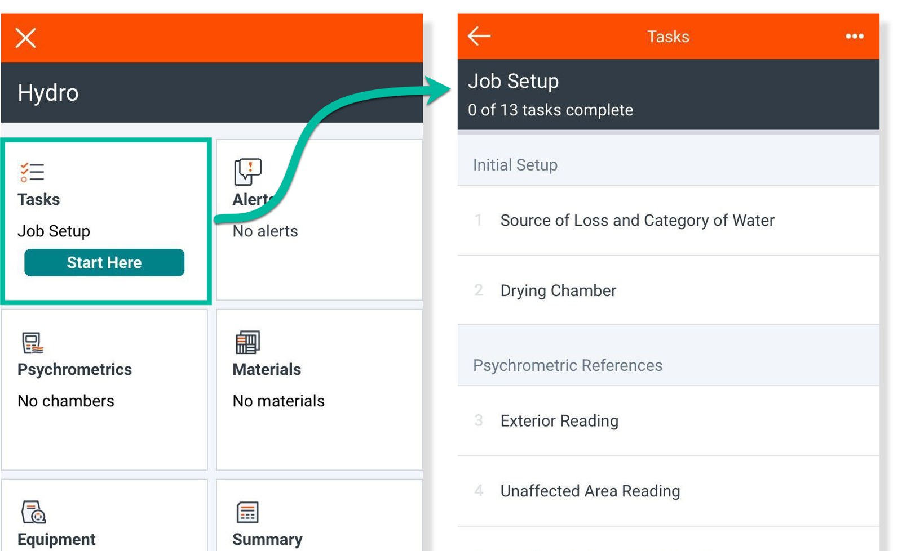

## 2. Drying Chamber (do this first) · crew 1.1

**Set up the chamber**

- **Drying Chamber** > pick rooms > mark **Affected**/**Unaffected** > **Done** > name > **Complete Task**
- More areas: **Add Another Chamber**
- Each chamber then gets its own reading, point and dehu tasks
- **Chamber first. It unlocks Affected Area and dehu tasks.**

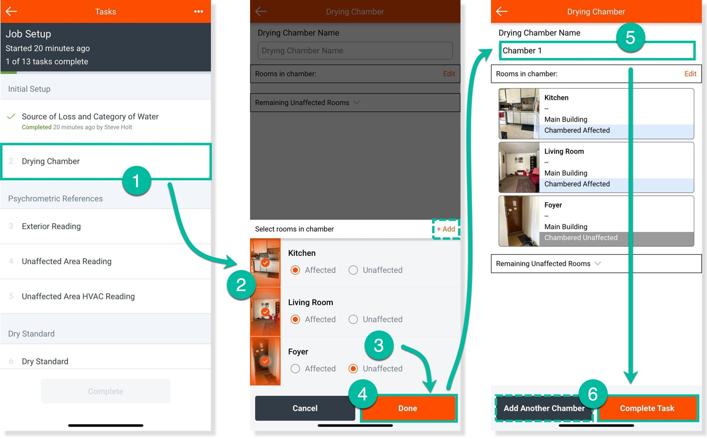

## 3. Dry Standards · crew 1.1

**One per wet material**

- **Dry Standard** > material > Meter **Change** > **Change Meter** > **Add Meter Photo** > check MC > **Save**
- Read it on the same material in a dry area
- **Drying Variance** defaults to 10% = your **Drying Goal**
- Next material: red **+** on the Dry Standard list
- Not listed? **+ Add** on the material list [verify in app]

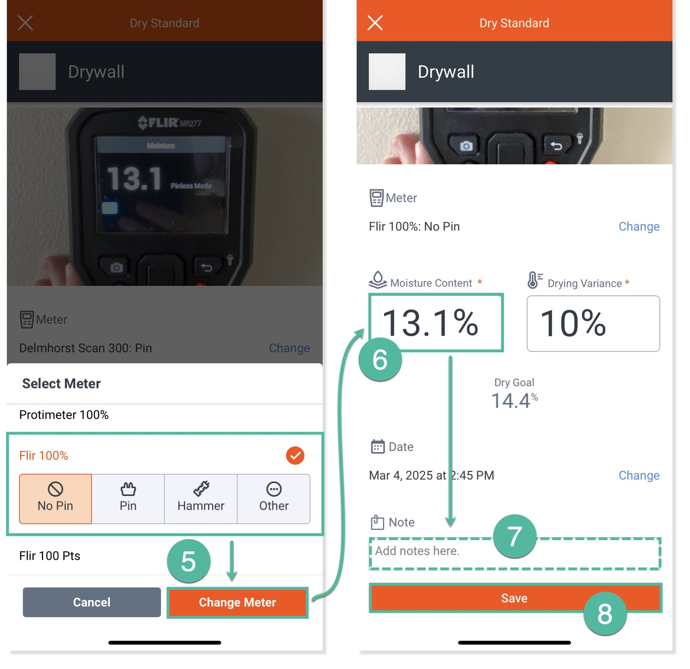

## 4. Moisture points (no map) · crew 1.1

**First point in a room**

- **Moisture Points** > **Place Moisture Points** (in the room) > material > **Done**
- **One point per affected material, per room. No map placement.**

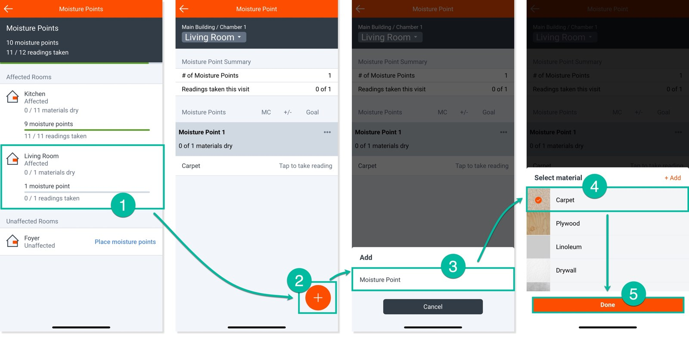

**More points**

- Open the room > red **+** > **Moisture Point** > material > **Done**
- New wet material later? Lead adds a point

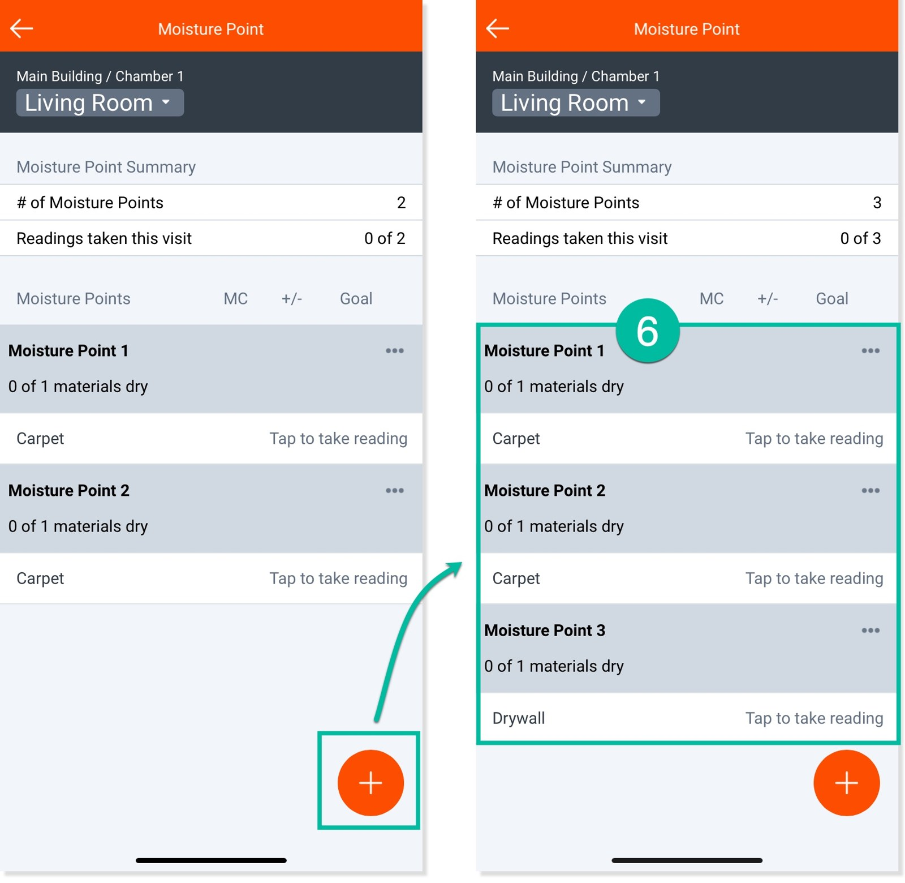

## 5. Daily readings · crew 1.2, 1.3

**Read each material**

- **Moisture Content Readings** > room > **Tap to take reading** > **Add Meter Photo** > check MC (auto-filled) > **Save**
- **That material's wettest spot today. It can move.**
- Meter shot: screen and material in frame

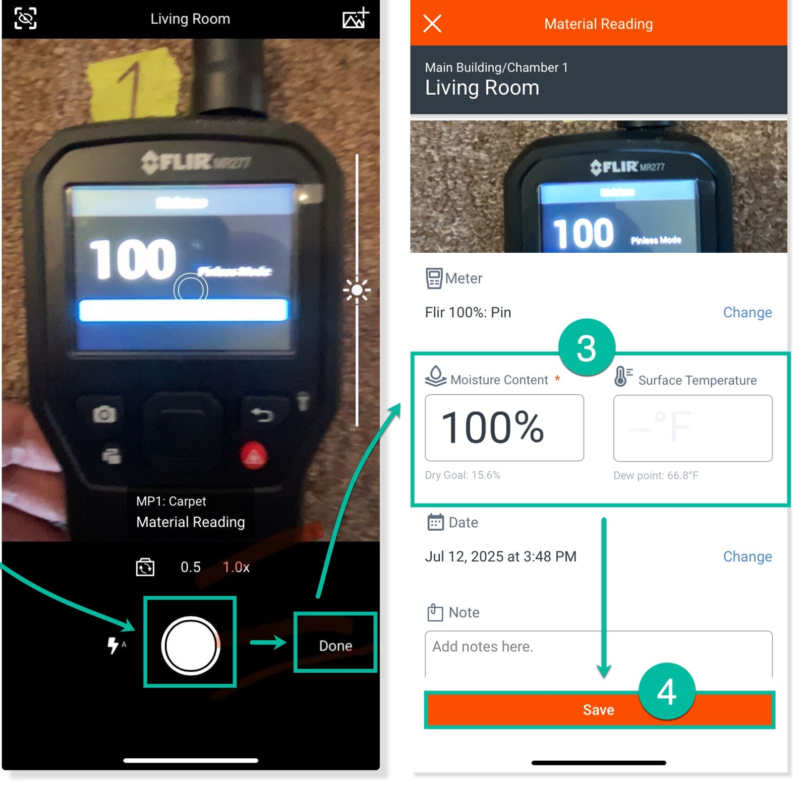

**Drying goal / dry status**

- List shows MC vs **Goal** and "x of y materials dry"
- Dry = at or below the Drying Goal

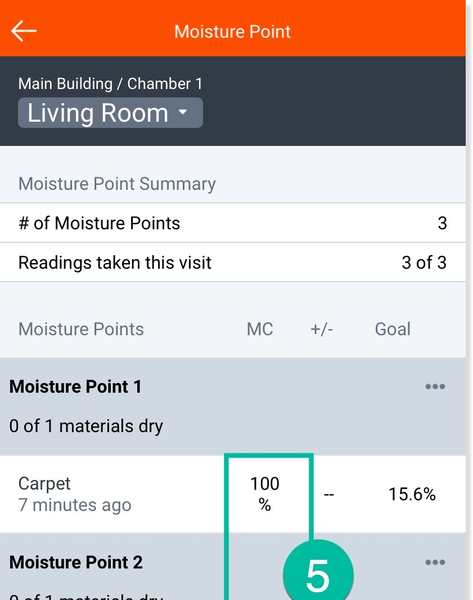

## 6. Air readings, every visit · crew 1.2

**Outside and unaffected**

- **Exterior Reading** > **Add Meter Photo** > Temp + RH > **Save** (or use local weather)
- **Unaffected Area Reading** > room > **Add Meter Photo** > Temp + RH > **Save**

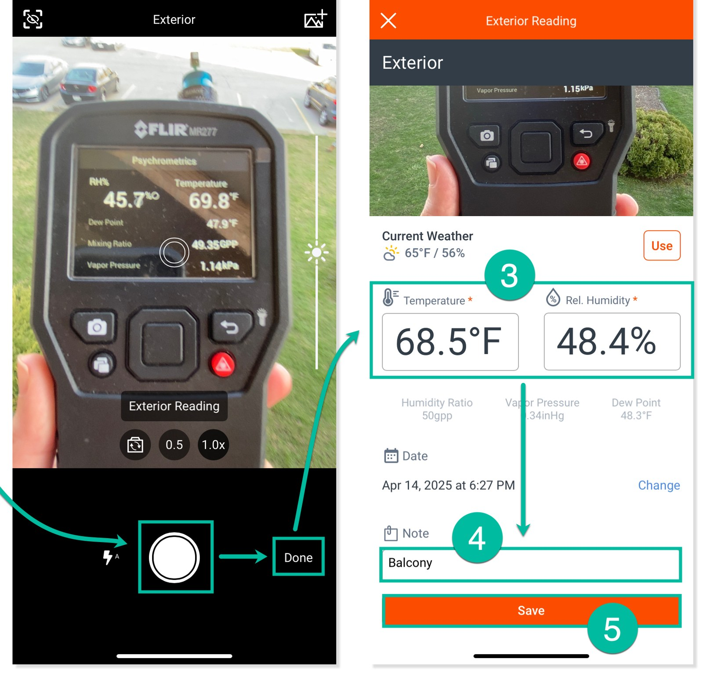

**Affected, each chamber**

- **Affected Area Reading** > room > **Add Meter Photo** > Temp + RH > **Save**
- High humidity alert on day 1 is expected

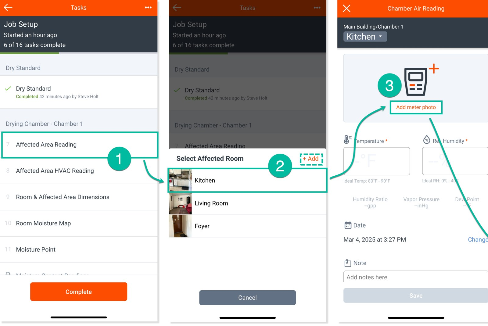

## 7. Dehu readings · crew 1.6

**Each dehu, every visit**

- **Dehumidifier Readings** > room > tap dehu > **Add Meter Photo** (exhaust) + **Add Timer Photo** (hour meter) > Temp, RH, **Hours Running** > **Save**
- Unit was off? Say so in **Notes**. Next room: room selector at top
- Placing new units: **Equipment Placement** > red **+** > room > **+** per type > **Place** [verify in app]

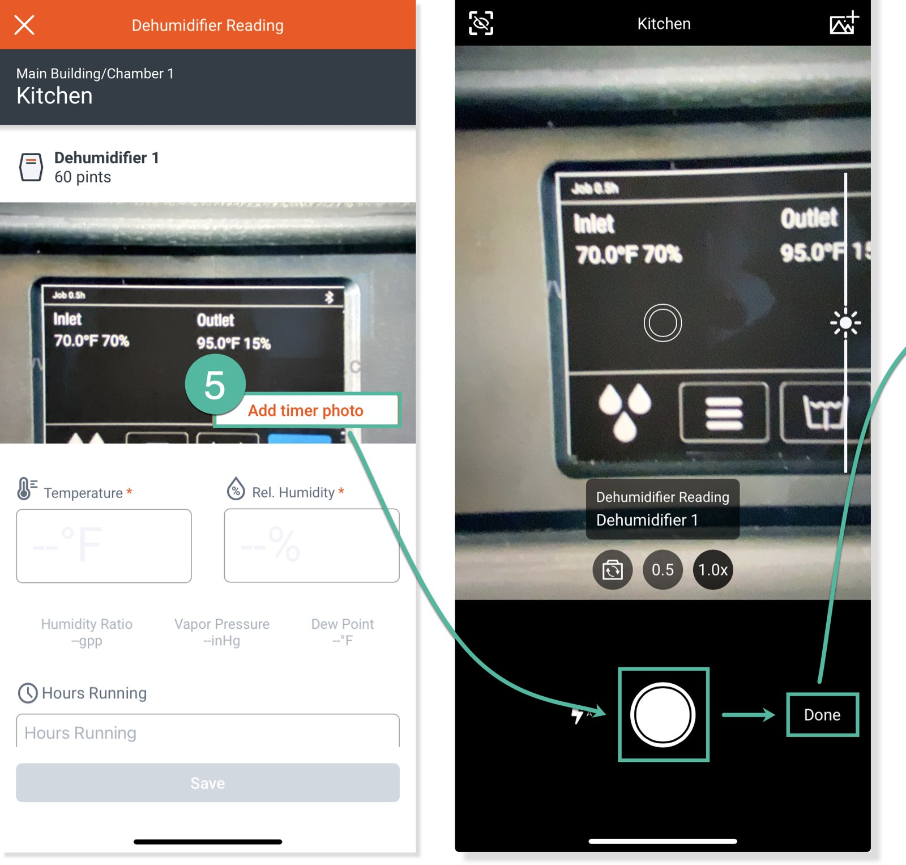

## 8. Subsequent visits

**Visit 1, 2, 3…**

- **Hydro** > **Tasks** (**Visit #**) > work through required tasks
- Fix a past visit: **Tasks** > **⋯** > **Change Visit**

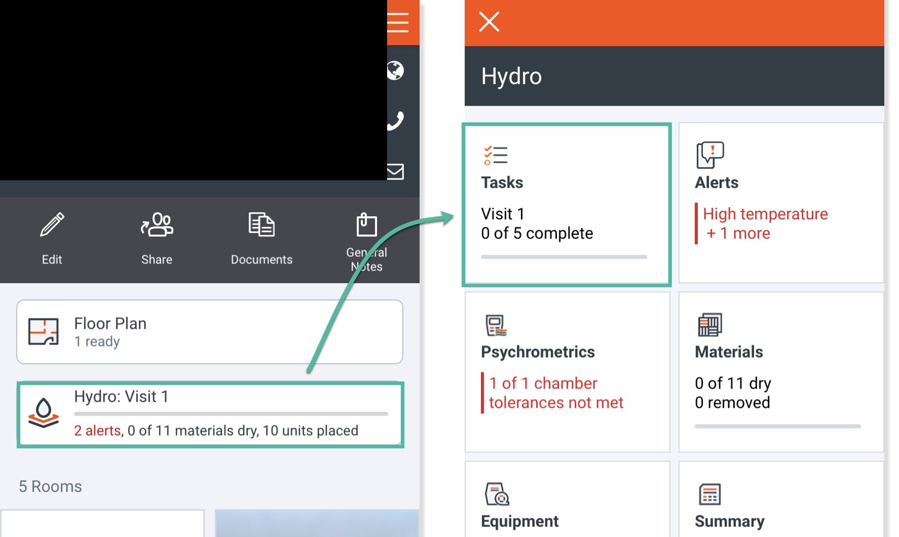

## 9. Complete

**Close the visit**

- Task list > **Complete**, every visit
- Then sync: app open until the **Network** icon shows no number
- Drying done: **Equipment** > **⋯** > **Remove All Equipment** > **Yes**

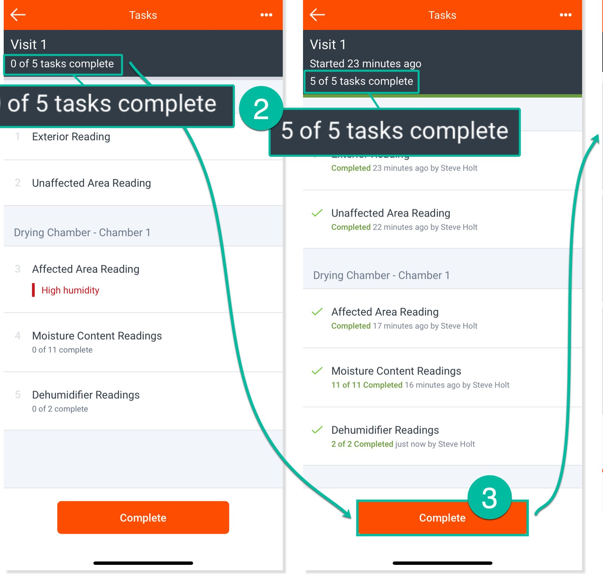

## 10. Hydro reports (PM/lead)

**Generate**

- **Claim** > **Documents** > **Generate Report** > **PDF Report** > report type > **Generate Report** [verify in app] (mobile labels)
- **Full**: all readings, photos, notes. **Summary**: first/last two readings, no photos. **Equipment**: equipment only. **Carrier**: carrier format, maps, photos, full dry log.

## Image sources

- `c_h_tasks.jpg`: Introduction to Hydro (https://encircleapp.zendesk.com/hc/en-us/articles/18377208883853-Introduction-to-Hydro), image https://encircleapp.zendesk.com/hc/article_attachments/34701077066637
- `c_h_chamber.jpg`: Drying Chamber Setup (https://encircleapp.zendesk.com/hc/en-us/articles/18377668096269-Drying-Chamber-Setup), image https://encircleapp.zendesk.com/hc/article_attachments/34709236858765
- `c_h_drystd.jpg`: Dry Standards & Drying Goals (https://encircleapp.zendesk.com/hc/en-us/articles/18378175356685-Dry-Standards-Drying-Goals), image https://encircleapp.zendesk.com/hc/article_attachments/34728067181197
- `c_h_mpplace.jpg`: Moisture Maps & Moisture Points (https://encircleapp.zendesk.com/hc/en-us/articles/18384800011021-Moisture-Maps-Moisture-Points), image https://encircleapp.zendesk.com/hc/article_attachments/38022470105613
- `c_h_mpplus.jpg`: Moisture Maps & Moisture Points (https://encircleapp.zendesk.com/hc/en-us/articles/18384800011021-Moisture-Maps-Moisture-Points), image https://encircleapp.zendesk.com/hc/article_attachments/38022462319629
- `c_h_read.jpg`: Moisture Maps & Moisture Points (https://encircleapp.zendesk.com/hc/en-us/articles/18384800011021-Moisture-Maps-Moisture-Points), image https://encircleapp.zendesk.com/hc/article_attachments/38022462320013
- `c_h_goal.jpg`: Moisture Maps & Moisture Points (https://encircleapp.zendesk.com/hc/en-us/articles/18384800011021-Moisture-Maps-Moisture-Points), image https://encircleapp.zendesk.com/hc/article_attachments/38022462320653
- `c_h_ext.jpg`: Psychrometric Reference Readings (https://encircleapp.zendesk.com/hc/en-us/articles/18377914971405-Psychrometric-Reference-Readings), image https://encircleapp.zendesk.com/hc/article_attachments/35850596401677
- `c_h_aff.jpg`: Drying Chamber Psychrometrics (https://encircleapp.zendesk.com/hc/en-us/articles/18384725633165-Drying-Chamber-Psychrometrics), image https://encircleapp.zendesk.com/hc/article_attachments/34736864013837
- `c_h_dehu.jpg`: Dehumidifier Readings (https://encircleapp.zendesk.com/hc/en-us/articles/18385065518861-Dehumidifier-Readings), image https://encircleapp.zendesk.com/hc/article_attachments/34741142677901
- `c_h_visit.jpg`: Subsequent Visits (https://encircleapp.zendesk.com/hc/en-us/articles/18385126323085-Subsequent-Visits), image https://encircleapp.zendesk.com/hc/article_attachments/34756450905741
- `c_h_complete.jpg`: Subsequent Visits (https://encircleapp.zendesk.com/hc/en-us/articles/18385126323085-Subsequent-Visits), image https://encircleapp.zendesk.com/hc/article_attachments/34756482302989
